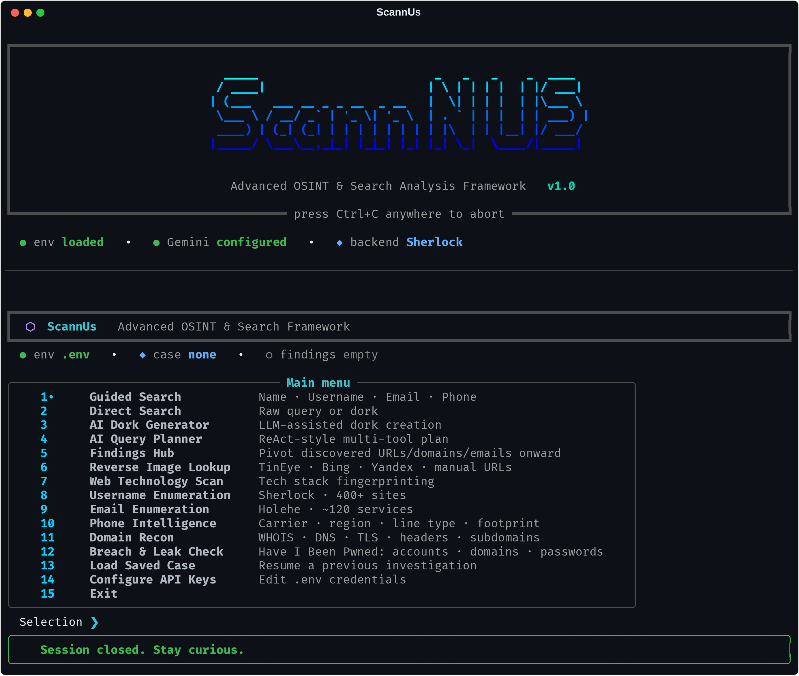
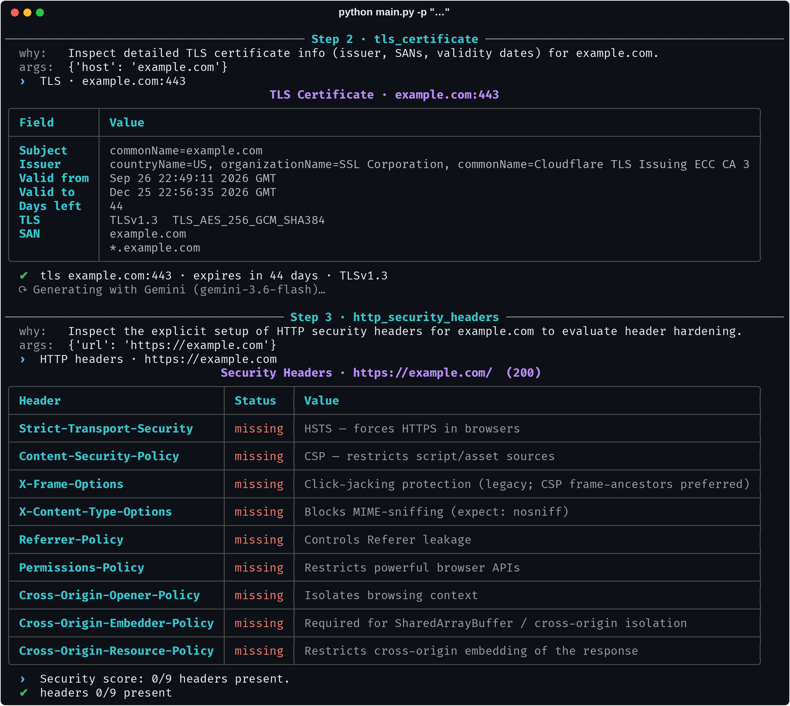
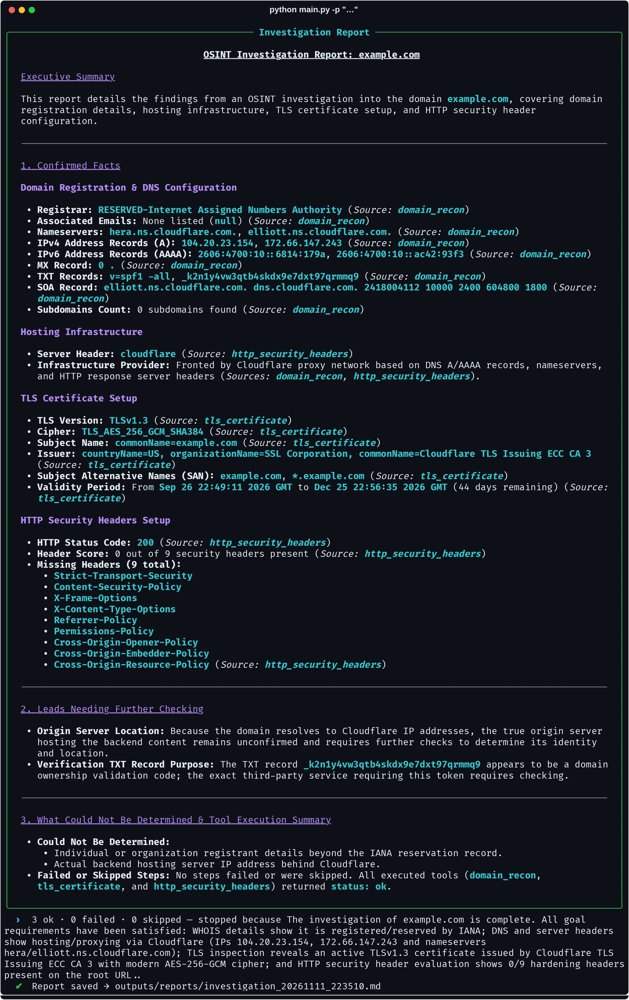
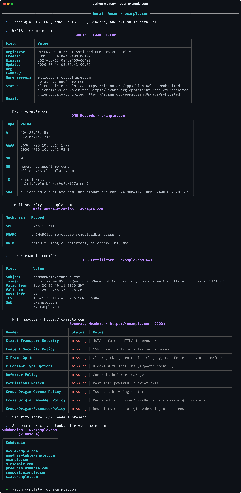
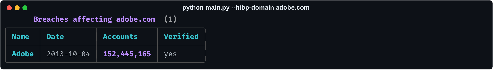
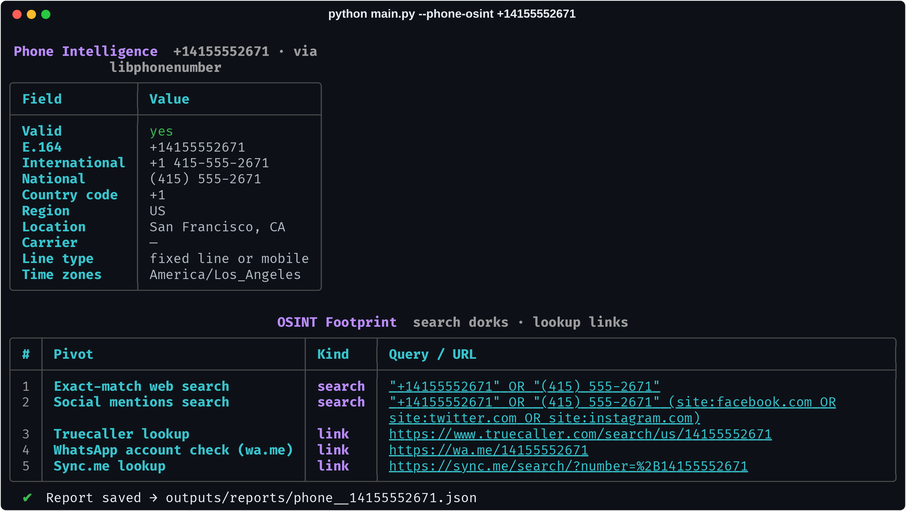

<div align="center">

```
 ____                        _   _
/ ___|  ___ __ _ _ __  _ __ | | | |___
\___ \ / __/ _` | '_ \| '_ \| | | / __|
 ___) | (_| (_| | | | | | | | |_| \__ \
|____/ \___\__,_|_| |_|_| |_|\___/|___/
```

**Advanced OSINT & Web Intelligence Framework**

[](https://python.org)
[](LICENSE)
[]()
[]()

📖 **User Guide:** [English](docs/USER_GUIDE_EN.md) · [Español](docs/USER_GUIDE_ES.md)

</div>

---

## Overview

**ScannUs** turns a raw lead — an email, a handle, a domain — into a structured, reproducible investigation. Multi-engine search, AI-assisted planning, breach intelligence, domain recon, deep PII extraction, and evidence collection, all behind a single interactive terminal.

### Highlights

| Capability | What you get |
|---|---|
| **Multi-engine search** | DuckDuckGo · Brave · Tavily · Exa, with automatic fallback — persistent SQLite cache |
| **Four AI providers** | Gemini · GPT-4o · Claude Sonnet 4.6 · local Ollama — token-streamed |
| **AI Query Planner** | Step-by-step investigations that build on each result, with a sourced final report, using 24 whitelisted tools |
| **Privacy toward the AI** | Card numbers, bank accounts, national IDs and leaked secrets in the formats ScannUs recognises reach the AI provider only as counts or `[withheld: …]`; page text is sent as data, and pages that try to instruct the AI are named in the report |
| **Evidence** | Every finding keeps its source, tool, date, content hash and confidence, saved with the case |
| **Breach intelligence** | HIBP — accounts, domains, breaches, k-anon passwords |
| **Domain recon** | WHOIS · DNS · TLS · security headers · crt.sh subdomains · Shodan |
| **PII & secret extraction** | 25+ identifiers: cloud keys · JWTs · BTC/ETH · IBAN · SSN/CPF/SIN · Colombian CC/TI/NIT |
| **Username enumeration** | Sherlock / Maigret — 400+ social sites; sites that also "find" a made-up handle of the same shape are left out as false positives |
| **Email enumeration** | Holehe — ~120 services (where an email is *registered*); services it could not check are reported as unchecked, not as absent |
| **Phone intelligence** | Offline libphonenumber lookup — validity, country, carrier, line type — plus ready-to-run search dorks |
| **Wayback Machine** | Snapshot fetch · PII extraction · unified-diff between dates |
| **Reverse image search** | TinEye · Bing Visual · Yandex · manual fallbacks |
| **Export** | Excel · CSV · JSON · HTML — clickable, styled |

---

## Screenshots

Captured from real runs against public targets (`example.com`, `adobe.com` and a sample phone number).

<p align="center">
  
</p>

**AI Query Planner** — the model picks one tool at a time, says why, and builds on each result:

<p align="center">
  
</p>

<details>
<summary><b>Final report</b> — confirmed facts with their source step, leads to check, and what could not be determined</summary>
<p align="center">
  
</p>
</details>

<details>
<summary><b>Domain recon</b> — WHOIS · DNS · email auth · TLS · security headers · crt.sh subdomains, probed in parallel</summary>
<p align="center">
  
</p>
</details>

**Breach intelligence (HIBP)** and **phone intelligence**:

<p align="center">
  
</p>
<p align="center">
  
</p>

---

## Quick Start

```bash
git clone https://github.com/kahz12/scannus.git
cd scannus
python3 -m venv venv && source venv/bin/activate
pip install -r requirements.txt
python -m spacy download en_core_web_lg   # language model for PII detection (401 MB)
python main.py -c          # configure .env (interactive wizard)
python main.py             # launch interactive TUI
```

**Requirements:** Python 3.11+, Firefox (for Selenium features). Optional: Ollama daemon for local LLM.

Keep the virtual environment active when you run ScannUs: Sherlock, Maigret and Holehe are command-line tools found on its `PATH`.

> ScannUs works with **zero API keys** (DuckDuckGo + free HIBP endpoints + crt.sh + Wayback + Sherlock). Add Gemini for free AI features.

---

## Usage

```bash
# Guided / direct search
python main.py -n "John Doe" -u "jdoe88" -e "john@corp.com"
python main.py -q 'site:linkedin.com "project manager"'

# AI Query Planner — multi-step investigation
python main.py -p "Investigate breaches affecting acme.com"

# Domain recon
python main.py --recon example.com

# Breach intelligence (HIBP)
python main.py --hibp-account target@example.com
python main.py --hibp-password         # interactive, hidden input

# Username / email / phone enumeration · reverse image
python main.py --username-enum jdoe88
python main.py --email-enum target@example.com    # where the email is registered (Holehe)
python main.py --phone-osint +14155552671         # offline number intelligence + dorks
python main.py -rev https://example.com/photo.jpg

# Cache management · export
python main.py --cache-stats
python main.py -q "query" --excel out.xlsx --json out.json

# Verbose diagnostics (engine hits, cache hit/miss, source failures)
python main.py --debug -q "query"     # logs to stderr + outputs/logs/scannus.log
```

**Full CLI reference, configuration details, investigation recipes, troubleshooting and FAQ:** see the [User Guide](docs/USER_GUIDE_EN.md) ([ES](docs/USER_GUIDE_ES.md)).

---

## Platform Support

| Platform | Status |
|---|---|
| **Linux / Windows / macOS** | Primary — all features available |
| **Termux / Android (aarch64)** | Alternative — Maigret unavailable; Sherlock works |

---

## Project Layout

```
ScannUs/
├── main.py                  # Entry point
├── cli/                     # Parser · TUI menus · UI theme · action handlers
├── core/                    # Config · AI agent (4 providers + planner) · cache · cases
├── search/                  # Engines · PII extraction · reverse image · username / email / phone
├── analysis/                # Web analyzer · tech scanner · domain OSINT · HIBP · Wayback
├── utils/                   # Media downloader · file downloader · export
└── docs/
    ├── USER_GUIDE_EN.md     # Full English user guide
    └── USER_GUIDE_ES.md     # Guía de usuario en español
```

---

## Documentation

| Topic | Location |
|---|---|
| Full feature walkthrough | [docs/USER_GUIDE_EN.md](docs/USER_GUIDE_EN.md) · [docs/USER_GUIDE_ES.md](docs/USER_GUIDE_ES.md) |
| Configuration wizard | User Guide §1.3 |
| AI Query Planner & tool catalog | User Guide §4 |
| Username, email & phone enumeration | User Guide §7 |
| What reaches the AI provider | User Guide §4 |
| HIBP & breach intelligence | User Guide §9 |
| Investigation recipes | User Guide §16 |
| Troubleshooting · FAQ · Glossary | User Guide §17–§19 |

---

## Disclaimer

ScannUs is intended strictly for **educational purposes, authorised security research, and lawful open-source intelligence gathering**. Users assume full responsibility for compliance with all applicable local, national, and international laws.

**Do not use ScannUs against systems, accounts, or data for which you do not have explicit authorisation.**

---

<div align="center">

Developed by **Ale**

</div>
